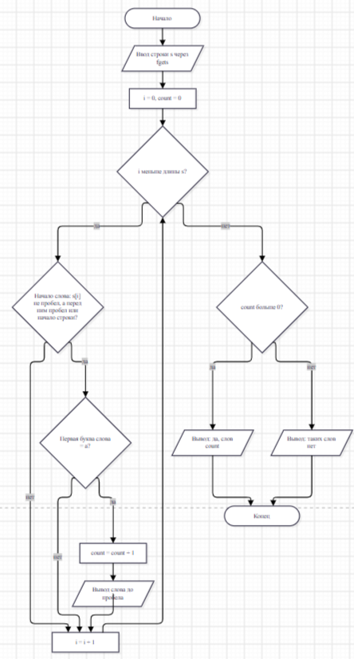

## Домашнее задание к лабораторной 13

### Вариант 11
#### Составить программу, которая во введенной пользователем строке проверяет, если в заданной строке слова, начинающиеся на букву ‘a’.
```
#define _CRT_SECURE_NO_WARNINGS
#include <stdio.h>
#include <string.h>
#include <ctype.h>
#include <locale.h>

// Лабораторная 13, задание 3 (ДЗ), вариант 11:
// проверить, есть ли в заданной строке слова, начинающиеся на букву 'a'.
// Слова разделены пробелами. Строку вводим через fgets (можно с пробелами).

int main()
{
    setlocale(LC_ALL, "Rus");
    char s[200];
    int i, j;
    int count = 0;

    puts("Введите строку (слова на латинице): ");
    fgets(s, 200, stdin);

    for (i = 0; i < strlen(s); i++)
    {
        // слово начинается там, где символ не пробел, а перед ним пробел (или начало строки)
        if (s[i] != ' ' && s[i] != '\n' && (i == 0 || s[i - 1] == ' '))
        {
            if (tolower((unsigned char)s[i]) == 'a')
            {
                count++;
                printf("Слово на 'a': ");
                for (j = i; s[j] != ' ' && s[j] != '\n' && s[j] != '\0'; j++)
                    printf("%c", s[j]);
                printf("\n");
            }
        }
    }

    if (count > 0)
        printf("Да, слов, начинающихся на 'a': %d\n", count);
    else
        printf("Нет, таких слов в строке нет\n");

    return 0;
}
```

### Вывод
####Я закрепила работу со строками как с массивами символов, которые заканчиваются нулевым байтом `'\0'`. Для ввода строки с пробелами я использовала `fgets()`, потому что `scanf` читает только до первого пробела. Слово начинается там, где символ не пробел, а перед ним пробел или начало строки. Для проверки первой буквы я применила функцию `tolower()`, чтобы подходили и большие, и маленькие буквы. Я поняла, что длину строки нужно считать до `'\0'` и что массив для строки должен быть достаточно большим. Цикл `for` по символам удобен, когда нужно проверить каждый символ строки по очереди.
